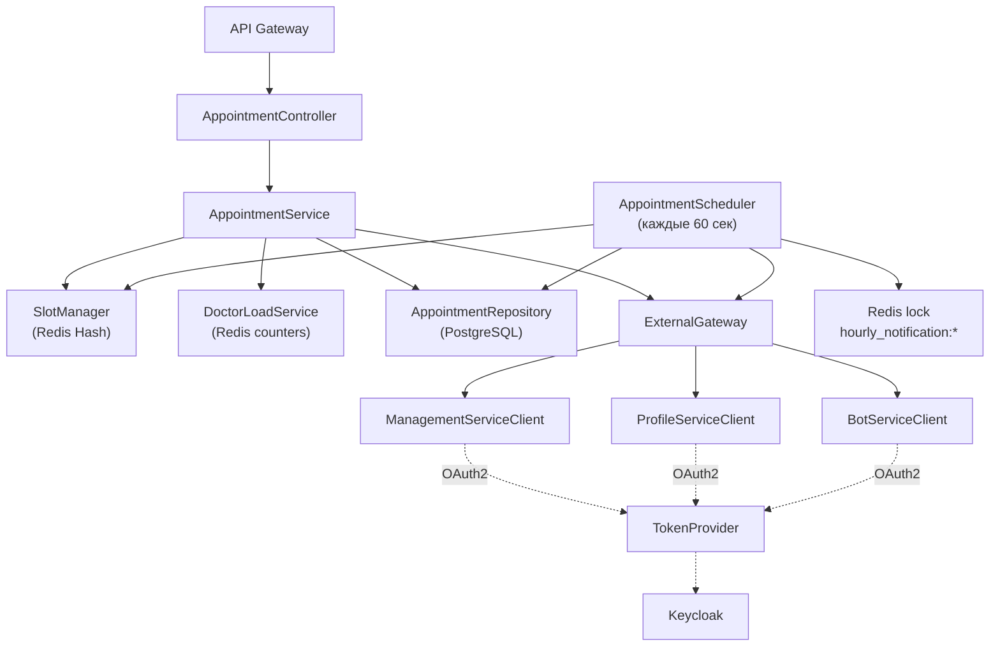
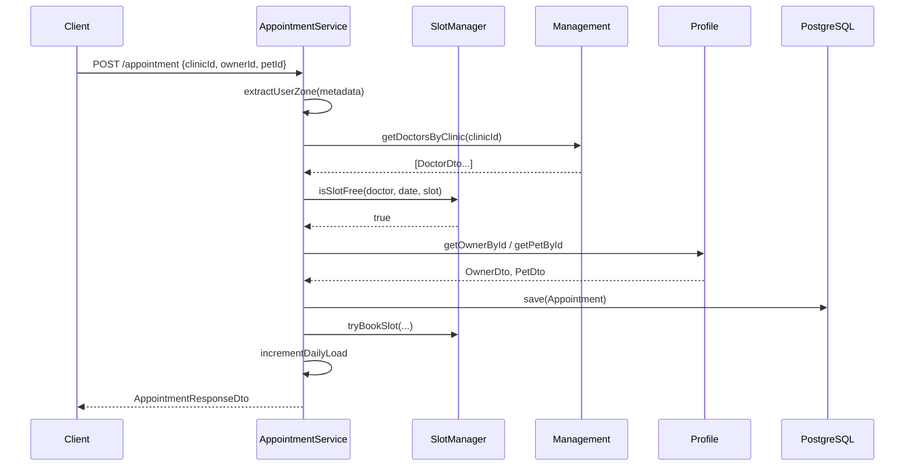

# 📅 Appointment Service


> Микросервис записи на приём: гибкое бронирование, автоматический подбор врача и слота, атомарное резервирование в Redis, напоминания и автоподтверждение приёмов.

---

## 📋 Назначение

**Appointment Service** — центральный координатор записи питомцев на приём. Он управляет полным жизненным циклом брони:

- создание записи с гибким сценарием бронирования;
- автоматический подбор **наименее загруженного** врача и ближайшего слота;
- атомарное резервирование слотов в Redis;
- учёт дневной нагрузки врачей;
- отмена записи с освобождением ресурсов;
- рассылка **напоминаний за час** до приёма;
- автоматическое **подтверждение** приёма при наступлении времени;
- ежедневная очистка устаревших слотов.

Сервис работает в **мультиклинической** среде: каждая запись привязана к конкретной клинике, а врачи подбираются только из её штата. Данные о врачах, клиниках, владельцах и питомцах сервис запрашивает через `ExternalGateway` у смежных микросервисов, кэшируя критичные для производительности показатели в Redis.

---

## ✨ Ключевые возможности

### Гибкое бронирование (4 сценария)

| Что указано | Поведение |
|---|---|
| Врач + время | Прямое бронирование указанного слота |
| Только врач | Поиск ближайшего свободного слота в графике врача (горизонт 14 дней) |
| Только время | Подбор наименее загруженного врача клиники, работающего в это время |
| Ничего (только клиника) | Полный автоподбор: поиск ближайшего свободного слота среди всех врачей клиники |

Во всех случаях `clinicId` **обязателен** — это гарантирует, что запись всегда привязана к конкретной клинике, и подбор врача ограничен её штатом.

### Атомарное резервирование слотов в Redis

Все слоты хранятся в **Redis Hash** по ключу:

```
slot:doctor:{doctorId}:date:{yyyy-MM-dd}
```

Поле хеша — временной слот (`HH:mm-HH:mm`), значение — `appointmentId`. Операция `putIfAbsent` гарантирует **отсутствие двойного бронирования** даже при параллельных запросах от разных клиентов. При любой ошибке на этапе бронирования слот немедленно освобождается через `releaseSlot`.

### Учёт нагрузки врачей

`DoctorLoadService` ведёт счётчики дневной загрузки каждого врача в Redis:

```
doctor:daily:load:{doctorId}:{yyyy-MM-dd} → N
```

Это позволяет:
- выбирать наименее загруженного специалиста при автоподборе;
- равномерно распределять поток пациентов;
- избегать перегрузки отдельных врачей.

Счётчик инкрементируется при успешном бронировании и декрементируется при отмене. Если после декремента значение уходит в минус — ключ удаляется, чтобы не накапливать «долги».

### Учёт часовых поясов

Клиент передаёт свой часовой пояс в `metadata.originalTimezone`. Сервис извлекает его методом `extractUserZone` и использует при вычислении слотов — это критично для клиентов из разных регионов. Если пояс не указан или некорректен, используется системный.

### Фоновые процессы (`AppointmentScheduler`)

Планировщик запускается **каждые 60 секунд** и выполняет две задачи:

1. **Напоминания за час.** Ищет записи с `startTime` в интервале `[now + 1h - 3min, now + 1h + 3min]`. Для каждого владельца с привязанным VK-аккаунтом отправляет уведомление через Bot Service. Защита от дублей — распределённая блокировка в Redis:
   ```
   hourly_notification:{appointmentId} → "sent" (TTL 55 минут)
   ```

2. **Автоподтверждение.** Записи со статусом `PENDING`, начало которых попадает в окно `[now - 5min, now + 5min]`, переводятся в `CONFIRMED`, слот из Redis удаляется, владельцу отправляется уведомление «Ваш приём уже начинается!».

Дополнительно, **ежедневно в 03:00** запускается задача очистки устаревших слотов: для всех подтверждённых приёмов, завершившихся более 7 дней назад, соответствующие записи удаляются из Redis.

### Коммуникация через Bot Service

Все уведомления отправляются через `BotServiceClient` (`POST /bot/notify/{userId}`). Владельцы без привязанного VK-аккаунта пропускаются — соответствующие записи всё равно сохраняются, а уведомление можно дослать позже.

---

## 🛠 Технологический стек

| Компонент | Технология |
|---|---|
| Язык | Java 21 |
| Фреймворк | Spring Boot 3 |
| Web | Spring Web MVC, `RestClient` |
| Persistence | Spring Data JPA, Hibernate |
| БД | PostgreSQL 16 (схема `appointment`) |
| Кэш | Redis 7 (Lettuce) |
| Безопасность | Spring Security OAuth2 Client, Keycloak (client_credentials) |
| Маппинг | MapStruct |
| Миграции | Liquibase |
| Валидация | Jakarta Bean Validation |
| Планировщик | Spring `@Scheduled` |
| Логирование | SLF4J + Logback |
| Контейнеризация | Docker (multi-stage build) |

---

## 🏗 Архитектура сервиса



---

## 📁 Структура проекта

```
appointment-service/
├── src/main/java/ru/sibsutis/appointment/
│   ├── AppointmentApplication.java
│   ├── api/
│   │   ├── client/
│   │   │   ├── BotServiceClient.java
│   │   │   ├── ManagementServiceClient.java
│   │   │   ├── ProfileServiceClient.java
│   │   │   ├── ExternalGateway.java
│   │   │   └── TokenProvider.java
│   │   ├── controller/
│   │   │   └── AppointmentController.java
│   │   ├── dto/
│   │   │   ├── AppointmentRequestDto.java
│   │   │   ├── AppointmentResponseDto.java
│   │   │   ├── ClinicDto.java
│   │   │   ├── DoctorDto.java
│   │   │   ├── OwnerDto.java
│   │   │   ├── PetDto.java
│   │   │   ├── TimeSlotDto.java
│   │   │   ├── SuccessResponseDto.java
│   │   │   └── ErrorResponseDto.java
│   │   └── mapper/
│   │       └── AppointmentMapper.java
│   └── core/
│       ├── model/
│       │   ├── Appointment.java
│       │   ├── AppointmentStatus.java
│       │   └── Specialization.java
│       ├── repository/
│       │   └── AppointmentRepository.java
│       ├── service/
│       │   ├── AppointmentService.java
│       │   ├── SlotManager.java
│       │   ├── DoctorLoadService.java
│       │   └── scheduler/
│       │       └── AppointmentScheduler.java
│       └── exception/
│           ├── BookingException.java
│           ├── SlotAlreadyBookedException.java
│           ├── NotificationException.java
│           └── GlobalExceptionHandler.java
├── src/main/resources/
│   ├── application.properties
│   └── db/changelog/
├── Dockerfile
├── build.gradle
└── README.md
```

---

## 📡 API

Все запросы идут через **API Gateway** (`/api/appointment/**`) с JWT в заголовке `Authorization: Bearer <token>`.

| Метод | Путь | Описание |
|---|---|---|
| `POST` | `/appointment` | Создать запись (гибкий сценарий) |
| `GET` | `/appointment` | Все записи |
| `GET` | `/appointment/doctor/{doctorId}` | Записи врача |
| `GET` | `/appointment/owner/{ownerId}` | Записи владельца |
| `DELETE` | `/appointment/{id}` | Отменить запись |
| `GET` | `/appointment/slots?date=&doctorId=` | Доступные слоты на дату |

### Пример: бронирование с автоподбором

```http
POST /api/appointment
Authorization: Bearer <JWT>
Content-Type: application/json

{
  "clinicId": "c1c2c3d4-...",
  "ownerId": "6dc0348a-0de9-4e4e-9fba-56472c76cc1e",
  "petId": "81e9f1d3-e878-448b-812f-12237b030faa",
  "metadata": {
    "originalTimezone": "Asia/Novosibirsk"
  }
}
```

Ответ:

```json
{
  "id": "d4a6f1b8-9e2c-4a1d-8f3e-7c5b9d2a1e4f",
  "clinicId": "c1c2c3d4-...",
  "clinicName": "ВетКлиника №1",
  "doctorId": "a1b2c3d4-...",
  "doctorFullName": "Иванов Иван",
  "ownerId": "6dc0348a-...",
  "ownerFullName": "Петров Пётр",
  "petId": "81e9f1d3-...",
  "petFullName": "Тимоша (пудель)",
  "startTime": "2026-10-15T10:00:00+07:00",
  "endTime": "2026-10-15T10:30:00+07:00",
  "status": "PENDING",
  "createdAt": "2026-10-07T14:22:11",
  "updatedAt": "2026-10-07T14:22:11"
}
```

### Пример: доступные слоты

```http
GET /api/appointment/slots?doctorId=a1b2c3d4-...&date=2026-10-15
```

```json
[
  { "startTime": "10:00", "endTime": "10:30" },
  { "startTime": "10:30", "endTime": "11:00" },
  { "startTime": "11:00", "endTime": "11:30" }
]
```

### Обработка ошибок

| Исключение | HTTP-статус | Когда возникает |
|---|---|---|
| `SlotAlreadyBookedException` | 409 | Слот уже занят |
| `EntityNotFoundException` | 404 | Врач, владелец, питомец или запись не найдены |
| `NullPointerException` (при отсутствии `clinicId`) | 400 | Не передан обязательный `clinicId` |
| `BookingException` | 500 | Общая ошибка бронирования |

---

## 🗄 Модель данных

### Сущность `Appointment` (PostgreSQL, схема `appointment`)

| Поле | Тип | Описание |
|---|---|---|
| `id` | UUID | PK, автогенерация |
| `clinicId` | UUID | ID клиники (обязательно) |
| `clinicName` | String | Кэш названия клиники |
| `doctorId` | UUID | ID врача |
| `doctorFullName` | String | Кэш ФИО врача |
| `ownerId` | String | ID владельца |
| `ownerFullName` | String | Кэш ФИО владельца |
| `petId` | String | ID питомца |
| `petFullName` | String | Кэш клички и породы |
| `startTime` | OffsetDateTime | Начало приёма (с TZ) |
| `endTime` | OffsetDateTime | Конец приёма |
| `status` | Enum | `PENDING` / `CONFIRMED` / `CANCELLED` |
| `metadata` | JSONB | Метаданные (часовой пояс) |
| `createdAt` | LocalDateTime | Автозаполнение (`@PrePersist`) |
| `updatedAt` | LocalDateTime | Автообновление (`@PreUpdate`) |

**Денормализация имён** — сознательное архитектурное решение: ФИО врача, владельца, питомца и название клиники кэшируются в самой записи, чтобы избежать межсервисных вызовов при чтении истории и отображении списков.

### Redis

| Ключ | Тип | Назначение |
|---|---|---|
| `slot:doctor:{doctorId}:date:{date}` | Hash | Занятые слоты (поле = `HH:mm-HH:mm`) |
| `doctor:daily:load:{doctorId}:{date}` | String | Счётчик дневной загрузки врача |
| `hourly_notification:{appointmentId}` | String (TTL 55 мин) | Блокировка отправки напоминания |

---

## 🔄 Ключевые сценарии

### Бронирование с полным автоподбором



### Отмена записи

1. `DELETE /appointment/{id}`.
2. Статус меняется на `CANCELLED`.
3. Слот освобождается в Redis.
4. Счётчик дневной нагрузки врача декрементируется.
5. Возвращается `SuccessResponseDto`.

### Напоминание за час

1. Планировщик находит записи со `startTime ∈ [now+1h±3min]`.
2. Проверяет владельца — есть ли `vkUserId`.
3. Пытается захватить `hourly_notification:{id}` в Redis с TTL 55 минут.
4. При успехе отправляет уведомление через Bot Service.
5. Повторные попытки в течение TTL пропускаются.

### Ежедневная очистка (03:00)

1. Находит все `CONFIRMED`-записи с `endTime < now - 7 дней`.
2. Удаляет соответствующие слоты из Redis.
3. PostgreSQL-записи **не удаляются** — история сохраняется.

---

## ⚙️ Конфигурация

### Переменные окружения

| Переменная | Назначение | Значение по умолчанию |
|---|---|---|
| `DB_HOST` / `DB_PORT` | PostgreSQL | `localhost` / `5433` |
| `DB_USERNAME` / `DB_PASSWORD` | Учётные данные | `postgres` / — |
| `REDIS_HOST` / `REDIS_PORT` | Redis | `localhost` / `6379` |
| `KEYCLOAK_ISSUER_URI` | Issuer URI для JWT | `http://localhost:8080/realms/clinic-realm` |
| `KEYCLOAK_EXTRA_ISSUER_URL` | Issuer для client_credentials | то же |
| `KEYCLOAK_CLIENT_SECRET` | Секрет клиента `appointment-service` | — |
| `GATEWAY_HOST` / `GATEWAY_PORT` | API Gateway | `localhost` / `8888` |

---

## 🚀 Запуск

### Локально (Docker Compose)

```bash
docker compose up -d appointment-service postgres redis keycloak
```

### Запуск только сервиса

```bash
cd services/appointment
./gradlew bootRun
```

### Сборка образа

```bash
docker build -t appointment-service:latest .
```

### Проверка

```bash
curl http://localhost:8081/actuator/health

curl -H "Authorization: Bearer $TOKEN" \
     "http://localhost:8888/api/appointment/slots?date=2026-10-15"
```

---

## 🔗 Связанные сервисы

| Сервис | Как используется |
|---|---|
| **Profile Service** | Получение владельца и питомца |
| **Management Service** | Получение врачей, клиник и графиков работы |
| **VK Bot Service** | Отправка напоминаний и уведомлений |
| **API Gateway** | Маршрутизация, проверка JWT |
| **Keycloak** | Выдача токенов для межсервисных вызовов |

---
